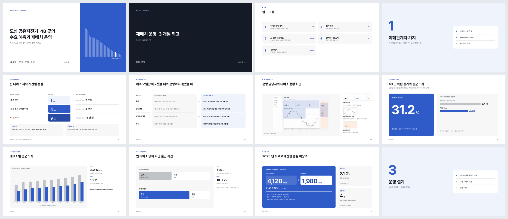
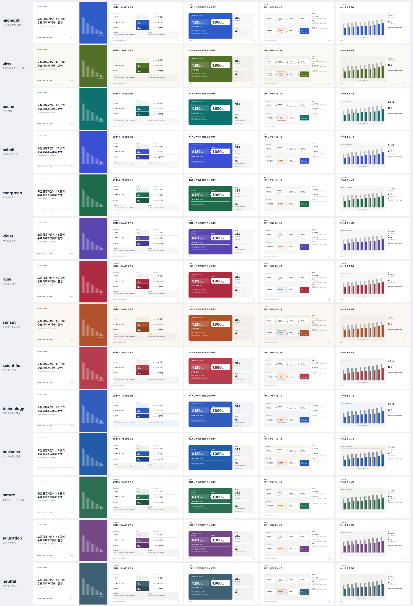

<div align="center">

# doc-design

[](#설치)
[](#설치)
[](#실행-환경)

발표 자료와 보고서를 디자인하는 에이전트 스킬입니다.<br>
발표는 PowerPoint에서 바로 고칠 수 있는 PPTX와 PDF로, 보고서와 원페이저는 PDF로 만듭니다.



</div>

자료만 건네고 "발표자료 만들어줘"라고 하면 에이전트가 장마다 무엇을 크게 보여 줄지 정하고 레이아웃과 테마를 골라 PPTX를 만듭니다. 글자, 표, 도식, 차트가 모두 PowerPoint 개체로 들어가므로 받은 뒤에 직접 고칠 수 있습니다. 만든 뒤에는 전체 페이지를 렌더해 잘림, 겹침, 작은 글씨를 확인합니다.

## 기능

- **편집되는 발표 파일**: 이미지로 붙인 슬라이드가 아니라 글자, 표, 도형, 차트 데이터가 살아 있는 PPTX를 만들고 같은 파일에서 PDF를 냅니다.
- **레이아웃 18종**: 핵심 수치, 차트와 해석, 표, 구간 비교, 이전과 이후, 흐름, 단계, 화면 캡처 설명, 성과 요약 등 증거 모양에 맞춰 고릅니다.
- **테마 14종**: 주제를 말하면 어울리는 테마를 고릅니다. `--palette` 하나만 바꾸면 전체 색이 바뀝니다.
- **보고서와 원페이저**: A4 보고서, A4 한 장, 수식과 그림이 많은 발표를 HTML 템플릿으로 만들어 PDF로 냅니다.
- **참고 디자인 분석**: 참고 PDF를 주면 전 페이지의 정렬, 여백, 밀도를 보고 원리만 가져옵니다. 도형과 색을 그대로 베끼지 않습니다.
- **검수**: 전체 축소판과 모든 장을 실제 크기로 봅니다. 발표자, 청중, 디자이너, 근거 검토자의 네 관점으로 다시 읽습니다.



## 설치

```bash
npx skills add kgyujin/doc-design-skill -g
```

설치할 도구(Claude Code, Codex)를 고르는 화면이 나옵니다. Node.js가 필요합니다. 제 다른 스킬과 함께 고르려면 `npx skills add kgyujin/agent-skills -g`를 쓰세요.

| 하려는 일 | 명령 |
| --- | --- |
| 갱신 | `npx skills update -g doc-design` |
| 삭제 | `npx skills remove -g doc-design` |

<details>
<summary>직접 설치(스킬을 고치면서 쓸 때)</summary>

```bash
git clone https://github.com/kgyujin/doc-design-skill.git ~/workspace/doc-design-skill
~/workspace/doc-design-skill/install.sh
```

`~/.claude/skills/doc-design`과 `~/.codex/skills/doc-design`에 이 저장소를 가리키는 링크가 생깁니다. `git pull`로 두 도구가 함께 갱신되고 `./install.sh --uninstall`로 링크를 지웁니다.

</details>

> [!NOTE]
> 한 컴퓨터에서는 npx 설치와 직접 설치 중 하나만 쓰세요. 두 방식이 같은 스킬 폴더를 씁니다.

## 사용법

Claude Code에서는 `/doc-design`, Codex에서는 `$doc-design`으로 부릅니다. 이름을 말하지 않아도 이런 요청이면 에이전트가 이 스킬을 고릅니다.

| 하고 싶은 일 | 요청 예시 |
| --- | --- |
| 자료로 새 발표 만들기 | `이 자료로 10분 발표자료 만들어줘. PPTX로 고칠 수 있게.` |
| 기존 PPT 다듬기 | `내용과 수치는 그대로 두고 글자 크기, 정렬, 도식만 다듬어줘.` |
| 분위기 비교하기 | `이 기획서로 구조가 다른 시안 3개 보여줘.` |
| 보고서 PDF | `이 분석 결과로 A4 보고서 PDF 만들어줘.` |
| 스타일만 바꾸기 | `이 보고서 내용은 두고 스타일만 editorial로 바꿔줘.` |

직접 명령으로도 만들 수 있습니다.

```bash
K=~/.claude/skills/doc-design/scripts/pdfdesign.py
python3 $K layouts                                                       # 레이아웃과 테마 목록
python3 $K pptx examples/layout-gallery.json ./out/gallery.pptx --palette olive
python3 $K init report ./out/report.html --topic "물류 운영 분석"           # A4 보고서 시작
python3 $K render ./out/report.html --preview                            # PDF와 미리보기
```

> [!TIP]
> 발표 파일은 `examples/layout-gallery.json`을 복사해 장마다 `layout`과 내용만 바꾸는 것이 가장 빠릅니다. 각 레이아웃의 필드는 [레이아웃 안내](references/layouts.md)에 있습니다.

## 실행 환경

| 하려는 일 | 필요한 것 |
| --- | --- |
| PPTX 만들기 | Python 3.9 이상(표준 라이브러리만) |
| PPTX를 PDF로 | PowerPoint의 '내보내기 → PDF', 또는 macOS Keynote(`render-pptx` 명령) |
| 보고서 PDF | Chrome, Chromium, Edge 중 하나 |
| 미리보기 PNG | Poppler |

기본 폰트는 Pretendard입니다. 받는 사람 컴퓨터에 폰트가 없으면 다른 글꼴로 바뀌어 보이므로 필요하면 폰트 이름을 함께 알려 주세요.

## 폴더 구성

```text
doc-design-skill/
├── SKILL.md            # 에이전트가 읽는 스킬 본문
├── install.sh          # Claude Code, Codex 링크 설치와 제거
├── scripts/            # pdfdesign.py(CLI), PPTX 작성기, 레이아웃, 검사 도구
├── references/         # 레이아웃, 테마, 발표 절차, 발표 검수, 디자인 규칙
├── templates/          # report, onepager, deck, talk HTML 템플릿
├── assets/             # 문서 스타일 CSS와 발표 테마
├── examples/           # 레이아웃 갤러리와 예제 발표(가상 데이터)
├── prompts/            # 발표 요청 양식
├── docs/               # README 그림
└── tests/              # 테스트(python3 -m unittest discover -s tests)
```

예제의 문구와 수치는 모두 가상 데이터입니다. 실제 발표에서는 사용자 자료로 바꿔 씁니다.
